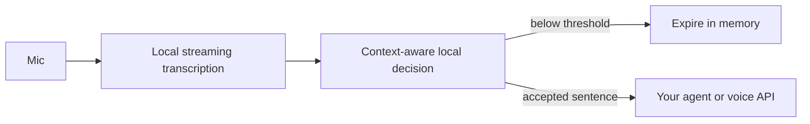

# Addressed

**An experimental, local alternative to a wake word.**

Addressed transcribes speech on your machine, gives a small decision model the current
sentence and recent conversation, and emits a request only when its score crosses a
threshold. The first sentence is preserved, so your agent can start with the request
you already spoke.

It is a front door for an agent, not an agent framework. It doesn't execute commands,
call a cloud API or require a cloud account. Bring your own consumer for the accepted
JSON events: Hermes, a voice API, a local assistant, or an existing application.



## Try it

Python 3.12+; microphone capture also needs PortAudio. On Debian/Ubuntu:

```bash
sudo apt install python3-venv libportaudio2
git clone https://github.com/AJHKetchup/addressed.git
cd addressed
python3 -m venv .venv
. .venv/bin/activate
pip install '.[speech]'
addressed setup --speech
addressed serve
```

In another terminal, with the same environment activated:

```bash
addressed listen --purpose 'Control television playback and volume.' \
  --threshold 0.70 --followup-threshold 0.60 --decisions
```

These are exploratory thresholds for trying the pipeline. `--decisions` prints all
transcripts locally while you tune it; leave that flag off afterward. Observe the
output before connecting a consumer that performs actions. Without threshold flags,
the more conservative defaults are 0.90 and 0.80.

`setup` explicitly downloads pinned, checksum-verified weights and a CPU runtime.
The decision model is Liquid AI's d1-omni-600M at Q8, about 407 MB; English streaming
ASR adds about 45 MB. No PyTorch or chat model is installed. The Python gate itself
uses only the standard library. Models are cached outside the repository, by default
under `~/.cache/addressed`.

The installer includes upstream CPU runtimes for Linux x64, Windows x64 and macOS
Intel/Apple Silicon. On Windows activate with `.venv\Scripts\Activate.ps1`; on macOS
install PortAudio with your package manager. Only Linux x64 has been exercised so far.
Other platforms can also use an existing local System One-compatible model server.

List microphones with `addressed devices`, then select one with `--device INDEX` or
`--device NAME`. Ctrl+C stops capture. Nothing starts automatically at boot.

## Use an existing transcript stream

No microphone or speech dependencies are needed for the text interface:

```bash
pip install .
printf '%s\n' 'Play the next episode.' | addressed text \
  --purpose 'Control television playback.'
```

By default every line is literal speech, including JSON-looking sentences. Use
`addressed text --jsonl` for structured events from a trusted integration. Feed actual
assistant replies back to give short answers like "yes" context:

```jsonl
{"text":"Play the next episode."}
{"role":"assistant","text":"Do you mean episode six?"}
{"text":"Yes."}
{"text":"Dialogue from the TV","source":"playback"}
{"role":"control","action":"reset"}
```

Known `playback` and `assistant` sources are rejected before inference. These are
annotations from your integration, not speaker identities inferred from microphone
audio. Assistant replies update context only during an active session. Ignored room
speech does not keep a session alive.

## Handoff contract

Only accepted requests go to stdout, one JSON object per line:

```json
{"type":"activate","session_id":"…","text":"Play the next episode.","score":0.96,"context":[]}
```

Subsequent accepted turns use `"type":"continue"` and the same session ID. `text` is
the current original transcript. `context` contains only earlier accepted user turns
and actual assistant replies; rejected room conversation is never included. Send the
context and then the current text to your agent once, or use the first `activate`
event to open your voice session. An expired conversation starts a new session.

See [the Hermes consumer](examples/hermes_stdio.py) for a minimal native Hermes
integration. For interactive follow-ups, feed its replies back through
`Gate.assistant_said()` in your application. Addressed deliberately owns no paid API
connection, credentials, shell execution or action permissions.

## Tune it for your room

```bash
addressed listen --threshold 0.95 --followup-threshold 0.85 \
  --purpose 'Control media playback and volume.'
```

Defaults are 0.90 to activate and 0.80 during a 30-second conversation. The gate keeps
up to six recent turns for at most 25 seconds. These thresholds are starting points,
not calibrated accuracy guarantees. A model score of 0.95 does **not** establish that
the speech was addressed to the assistant 95% of the time.

Use `--decisions` to inspect scores locally. That option prints **all** transcribed
sentences to stderr, including rejected speech; leave it off for ordinary use.
You can replay a mono PCM16 recording with `addressed listen --wav sample.wav`.
Replaying a recording is not a test of far-field microphone performance.

The detector is an experimental semantic gate, not authentication or permission to
execute sensitive actions. Text can be ambiguous; quoted requests and conversations
between people can trigger it. It has no bundled speaker recognition or acoustic echo
canceller. For a TV or speaker, use your OS's echo-cancelled microphone input. Continuous
transcription costs more CPU than a keyword detector. Audio queue overflow discards a
discontinuous recording, and old queued utterances expire instead of running late.

Development check: the complete audio-to-handoff path was run on Linux x64 with an
AMD A6-7310, 3.2 GiB RAM and no AVX2. A synthetic speech replay ignored a background
sentence and emitted `TURN THE VOLUME DOWN PLEASE` unchanged at the example 0.70
threshold. A subsequent `Yes.` continued a session after an assistant question.
Actual microphone capture was also exercised. The model server used about 480 MiB
RSS; decisions took several seconds on that old CPU. This is a workflow check, not an
accuracy or speed benchmark. The small ASR model can garble names and background speech.
Far-field addressing accuracy, false activations per hour, other operating systems
and a live cloud voice session have not been established.

## Privacy and models

Raw audio isn't saved by Addressed. The gate keeps rejected transcripts briefly in
bounded process memory; the local model server has its own inference buffers while
running. Accepted transcripts leave the gate only via stdout; your consumer
decides where to send them. Decision requests are restricted to loopback addresses
and HTTP redirects are disabled. If the model is unavailable or its response is
malformed, the gate stays closed. Stop the process to stop listening and clear memory.

`--decision-url http://127.0.0.1:PORT` uses an existing local
`/v1/systemone` server. This is compatible with llama.cpp and jevos; no proprietary
Jev weights are included. The supplied model is a general decision model, not a
specially trained addressed-speech detector.

Code: [MIT](LICENSE). Model weights and runtime keep their own upstream licenses:
[Liquid AI d1](https://huggingface.co/LiquidAI/d1-omni-600M-GGUF),
[llama.cpp](https://github.com/ggml-org/llama.cpp),
[English ASR](https://huggingface.co/csukuangfj/sherpa-onnx-streaming-zipformer-en-20M-2023-02-17),
[sherpa-onnx](https://github.com/k2-fsa/sherpa-onnx).

The idea is related to
[device-directed utterance detection](https://www.amazon.science/publications/device-directed-utterance-detection).
Research finds audio and text together improve detection; this first version gates
transcripts and accepts source annotations. It does not claim those research results.
