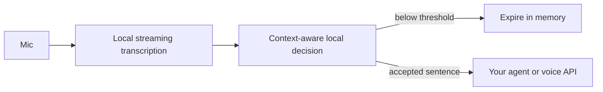

# Addressed

**An experimental, local alternative to a wake word.**

Addressed transcribes speech on your machine, gives a small decision model the current
sentence and recent conversation, and emits a request only when its score crosses a
threshold. The first sentence is preserved, so your agent can start with the request
you already spoke.

The local gate doesn't execute commands or require a cloud account. Bring your own
consumer for accepted JSON events, or use the optional Hermes + OpenAI Realtime example
below. Realtime owns the conversation; Hermes executes bounded application tools.



## Try it

Python 3.12+; microphone capture also needs PortAudio. On Debian/Ubuntu:

```bash
sudo apt install python3-venv libportaudio2
git clone https://github.com/AJHKetchup/addressed.git
cd addressed
python3 -m venv .venv
. .venv/bin/activate
pip install '.[speech]'
addressed setup --speech
addressed serve
```

In another terminal, with the same environment activated:

```bash
addressed listen --purpose 'Control television playback and volume.' \
  --threshold 0.70 --followup-threshold 0.60 --decisions
```

These are exploratory thresholds for trying the pipeline. `--decisions` prints all
transcripts locally while you tune it; leave that flag off afterward. Observe the
output before connecting a consumer that performs actions. Without threshold flags,
the more conservative defaults are 0.90 and 0.80.

`setup` explicitly downloads pinned, checksum-verified weights and a CPU runtime.
The decision model is Liquid AI's d1-omni-600M at Q8, about 407 MB; English streaming
ASR uses Vosk small English, a roughly 40 MB download. No PyTorch or chat model is installed. The Python gate itself
uses only the standard library. Models are cached outside the repository, by default
under `~/.cache/addressed`.

The installer includes upstream CPU runtimes for Linux x64, Windows x64 and macOS
Intel/Apple Silicon. On Windows activate with `.venv\Scripts\Activate.ps1`; on macOS
install PortAudio with your package manager. Only Linux x64 has been exercised so far.
Other platforms can also use an existing local System One-compatible model server.

List microphones with `addressed devices`, then select one with `--device INDEX` or
`--device NAME`. Ctrl+C stops capture. Nothing starts automatically at boot.

## Use an existing transcript stream

No microphone or speech dependencies are needed for the text interface:

```bash
pip install .
printf '%s\n' 'Play the next episode.' | addressed text \
  --purpose 'Control television playback.'
```

By default every line is literal speech, including JSON-looking sentences. Use
`addressed text --jsonl` for structured events from a trusted integration. Feed actual
assistant replies back to give short answers like "yes" context:

```jsonl
{"text":"Play the next episode."}
{"role":"assistant","text":"Do you mean episode six?"}
{"text":"Yes."}
{"text":"Dialogue from the TV","source":"playback"}
{"role":"control","action":"reset"}
```

Known `playback` and `assistant` sources are rejected before inference. These are
annotations from your integration, not speaker identities inferred from microphone
audio. Assistant replies update context only during an active session. Ignored room
speech does not keep a session alive.

## Handoff contract

Only accepted requests go to stdout, one JSON object per line:

```json
{"type":"activate","session_id":"…","text":"Play the next episode.","score":0.96,"context":[],"purpose":"Control television playback."}
```

Subsequent accepted turns use `"type":"continue"` and the same session ID. `text` is
the current original transcript. `context` contains only earlier accepted user turns
and actual assistant replies; rejected room conversation is never included. Send the
context and then the current text to your agent once, or use the first `activate`
event to open your voice session. An expired conversation starts a new session.

See [the Hermes consumer](examples/hermes_stdio.py) for a minimal native Hermes
integration. For interactive follow-ups, feed its replies back through
`Gate.assistant_said()` in your application. This text interface has no paid connection.

## A voice session that knows when to stop

The optional [voice example](examples/hermes_realtime.py) handles the complete handoff:

1. Local transcription and the gate listen until a request is accepted.
2. Local capture stops. A new voice connection receives the assistant purpose,
   trusted application context, accepted dialogue and the first sentence exactly once.
   Realtime answers that sentence without making you repeat it. Hermes receives the
   accepted conversation and application context when an action is delegated.
3. Realtime converses directly, asks questions and calls `hermes_task` for actions.
   Hermes executes its bounded toolset and returns receipts. Realtime explains the result.
   No OpenAI Agents SDK is used.
4. Realtime can call `end_conversation` when you are done. The session waits for its
   farewell to finish playing, then closes the WebSocket. Interrupting the farewell
   keeps the conversation open for your follow-up.
5. Thirty seconds of silence after a completed exchange closes the connection.
   A five-minute hard limit also closes it, including when an agent or audio task is
   stuck. Connection shutdown is bounded. Errors also return to fresh local listening.

Finishing one command does not end the conversation automatically. While voice is
active, the local gate is paused, so its shorter context TTL cannot create a second
session. On exit it resets and discards queued audio rather than reopening from an
old trigger. No cross-session memory is saved by this example.

Keep `addressed serve` running. Install the optional transport, then run:

```bash
pip install '.[speech,realtime]'
# Set OPENAI_API_KEY securely in your environment; never commit it.
python examples/hermes_realtime.py \
  --hermes-python /path/to/hermes/venv/bin/python \
  --tool-module /path/to/application/actions.py \
  --purpose 'Discuss and select TV programs.' \
  --context 'Cowboy Bebop means the 1998 anime, English dub.'
```

This uses an existing, separately configured native Hermes installation and its
reasoning provider. Supply a trusted local module with `definitions()` returning
`(name, function, description)` tuples for the tools you authorize. Each function
returns a JSON object, with an `error` field on failure. The worker enables exactly
that toolset, never Hermes' default shell or other unrelated tools. It returns factual
results and tool receipts; it does not write the spoken conversation.

For example, an application module can expose `search_library`, `request_series`,
`schedule_show` and `request_status`. A request such as "Add Samurai Champloo and play
it every day at 1 PM" remains in Realtime's context while it asks "Sub or dub?" After
the answer, it delegates both acquisition and the daily slot to Hermes. The application's
tools must persist queued work and pending schedules beyond the voice session; a pending
download is never reported as already playable. The Channel 3 deployment uses native
SABnzbd imports, persistent series requests and Tunarr time slots for those actions.

The conversational policy also distinguishes a temporary "play something else" from
"never play this again," asks application tools to persist bans/time restrictions,
and keeps a one-episode trial separate from later full-series approval. YouTube requests
distinguish finding, downloading and playing one video. These capabilities require the
corresponding application tools; the generic gate does not invent or execute them.
An action module can define `set_context(context)` to bind tools to the accepted owner
turn, for example to prevent an initial conditional request from approving its own trial.

Applications can also use `VoiceSession` with an `execute(task, context)` coroutine that
returns JSON-serializable facts. Application context must be intentionally selected
facts, not secrets or rejected room conversation. This package supplies the voice/tool
handoff; it does not bundle a downloader or replace your application's scheduler.

`--idle-seconds` and `--max-seconds` change the limits. Input uses `--device INDEX`;
output uses your OS default speaker. Use echo cancellation or headphones to prevent
the assistant/TV from being transcribed as a person. This example doesn't install an
echo canceller, select HDMI automatically, or change your TV service.

**Privacy changes while voice is active:** the microphone streams to OpenAI until the
socket closes. Local pre-wake audio and rejected transcripts are not uploaded. Accepted
dialogue and selected app context go to Realtime and your configured Hermes provider.
Voice requires a separately billed API key. Without one, the original local gate still
works. The adapter was checked with a real loopback WebSocket and native Hermes;
live OpenAI conversation, model clarification choices, interruption timing on hardware and far-field performance remain
unverified.

The adapter uses documented [Realtime conversation events](https://developers.openai.com/api/docs/guides/realtime-conversations)
and [client events](https://developers.openai.com/api/reference/resources/realtime/client-events).
Realtime's VAD idle timeout prompts again; it does not disconnect. This application
owns the actual socket close and waits for speaker drain separately from `response.done`.

## Tune it for your room

```bash
addressed listen --threshold 0.95 --followup-threshold 0.85 \
  --purpose 'Control media playback and volume.'
```

Defaults are 0.90 to activate and 0.80 during a 30-second conversation. The gate keeps
up to six recent turns for at most 25 seconds. These thresholds are starting points,
not calibrated accuracy guarantees. A model score of 0.95 does **not** establish that
the speech was addressed to the assistant 95% of the time.

Use `--decisions` to inspect scores locally. That option prints **all** transcribed
sentences to stderr, including rejected speech; leave it off for ordinary use.
You can replay a mono PCM16 recording with `addressed listen --wav sample.wav`.
Replaying a recording is not a test of far-field microphone performance.

The detector is an experimental semantic gate, not authentication or permission to
execute sensitive actions. Text can be ambiguous; quoted requests and conversations
between people can trigger it. It has no bundled speaker recognition or acoustic echo
canceller. For a TV or speaker, use your OS's echo-cancelled microphone input. Continuous
transcription costs more CPU than a keyword detector. Audio queue overflow discards a
discontinuous recording, and old queued utterances expire instead of running late.

Development check: the complete audio-to-handoff path was run on Linux x64 with an
AMD A6-7310, 3.2 GiB RAM and no AVX2. A generated replay produced "add samurai sharply
to our library and play it every day at one pm" and activated at the example 0.70
threshold. Both intents survived; the title still needs clarification. An earlier
transducer ASR lost the beginning of that request, so Vosk now supplies local transcripts.
Actual microphone capture was also exercised. The decision server used about 480 MiB
RSS; decisions took several seconds on that old CPU. This is a workflow check, not an
accuracy or speed benchmark. The small ASR model can garble names and background speech.
Far-field addressing accuracy, false activations per hour, other operating systems
and a live cloud voice session have not been established.

## Privacy and models

Raw audio isn't saved by Addressed. The gate keeps rejected transcripts briefly in
bounded process memory; the local model server has its own inference buffers while
running. Accepted transcripts leave the text CLI only via stdout; your consumer
decides where to send them. The optional voice example's cloud behavior is described
above. Decision requests are restricted to loopback addresses
and HTTP redirects are disabled. If the model is unavailable or its response is
malformed, the gate stays closed. Stop the process to stop listening and clear memory.

`--decision-url http://127.0.0.1:PORT` uses an existing local
`/v1/systemone` server. This is compatible with llama.cpp and jevos; no proprietary
Jev weights are included. The supplied model is a general decision model, not a
specially trained addressed-speech detector.

Code: [MIT](LICENSE). Model weights and runtime keep their own upstream licenses:
[Liquid AI d1](https://huggingface.co/LiquidAI/d1-omni-600M-GGUF),
[llama.cpp](https://github.com/ggml-org/llama.cpp),
[Vosk English model](https://alphacephei.com/vosk/models),
[Vosk API](https://github.com/alphacep/vosk-api).

The idea is related to
[device-directed utterance detection](https://www.amazon.science/publications/device-directed-utterance-detection).
Research finds audio and text together improve detection; this first version gates
transcripts and accepts source annotations. It does not claim those research results.
